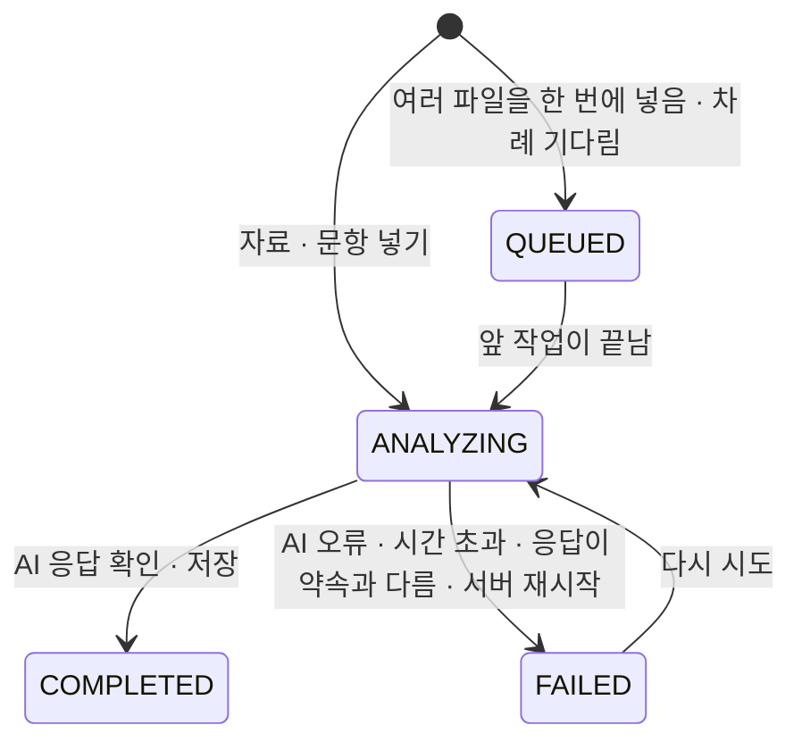

# WOOWANGTHON_TEAM_12_BE

2026 AI 우왕톤 12팀 「내가 우왕이 될 상인가」 — **차곡** 백엔드. 흩어진 기록은 차곡차곡 정리하고, 지원서엔 딱 맞게 꺼내 쓰는 AI 동료.

**서비스: https://app-woowang.miroda.live** · API `https://api-woowang.miroda.live/api`. 심사용 테스트 계정은 제출 폼에 있다.

프로젝트 개요 · 문제 · AI 검증 · 아키텍처 · 결정 기록은 [ETC 레포](https://github.com/woowangthon/WOOWANGTHON_TEAM_12_ETC). 스택을 고른 이유는 ETC [ADR-003](https://github.com/woowangthon/WOOWANGTHON_TEAM_12_ETC/blob/main/docs/decisions/ADR-003-stack-and-ai-boundary.md) · 배포는 [ADR-004](https://github.com/woowangthon/WOOWANGTHON_TEAM_12_ETC/blob/main/docs/decisions/ADR-004-deploy.md).

## 이 레포가 맡는 것

- 인증 · 저장 · 사용자 구분 · 하루 분석 한도 · 분석 작업(뒤에서 돌고 상태 · 다시 시도를 남긴다)
- **AI 서버를 부르는 유일한 곳** — AI 응답이 요청과 맞는지(후보 ID · 같은 경험의 근거인지 · 개수 · 출처 상태와 근거 표시가 서로 맞는지) 확인하고, 어긋나면 저장하지 않는다. 글자 단위로 근거를 원본과 대조하는 일은 AI 서버가 한다. AI 가 실패하면 정해 둔 답으로 채우지 않고 실패 이유를 남긴다
- 출처 상태(원문에서 확인 · 내가 입력 · 확인 필요)와 수행 주체를 데이터로 나눠 쌓는다
- MCP 서버 — 사용자의 AI(Claude 등)와 홈의 차곡이가 같은 도구를 쓴다(ETC ADR-008)

## 분석 작업이 도는 길

자료를 넣으면 BE 가 **한 번에** 원본 저장 · 작업 만들기 · 하루 횟수 차감을 끝내고 바로 응답한다(202). 실제 분석은 뒤에서 돈다.



- 코드: `AnalysisService`(트랜잭션 안: 저장 · 작업 · 횟수) → `ExtractionRunner`(`@Async`, 트랜잭션 밖: AI 호출 · 결과 저장). 문항 추천 · 초안 · 차곡이 일도 같은 모양이다(`MatchRunner` · `DraftRunner` · `ChagokRunner`).
- 사용자는 기다리지 않고 다른 화면을 쓴다. 작업 상태는 새로고침해도 이어진다. AI 호출 제한은 120초(동기 호출 60초)다.
- **일이 안 되면 그 일만 `FAILED`(이유 포함)가 되고 정해진 결과로 채우지 않는다.** 다른 작업과 쌓인 기록은 그대로다.
- 서버가 분석 도중 꺼지면 `InterruptedJobCleaner` 가 시작할 때 멈춰 있던 작업을 실패로 돌려 다시 시도할 수 있게 하고, 남은 차례를 이어 돌린다.
- 하루 한도는 일을 시작하는 그 묶음 안에서 센다(`UsageLimiter`). 동시에 눌러도 한도를 넘지 않는다. 실패한 분석도 센다(LLM 은 이미 불렸을 수 있다).
- 비어 있는 STAR 는 BE 가 알아서 뒤에서 정리한다(`StarSweeper`, 횟수를 세지 않음 — [ADR-019](https://github.com/woowangthon/WOOWANGTHON_TEAM_12_ETC/blob/main/docs/decisions/ADR-019-star-no-auto-resort.md)).

### AI 응답을 받아 BE 가 확인하는 것

글자 단위 근거 대조와 숫자 대조는 AI 서버가 한다. BE 는 **응답이 요청과 맞는지**를 본다 — 하나라도 어기면 아무것도 저장하지 않고 작업을 `FAILED` 로 둔다.

| 응답 | BE 가 확인하는 것 |
| --- | --- |
| 추출 | `SOURCE_CONFIRMED` 는 근거가 1개 이상이고 **전부 `matched: true`** 일 때만. 확인하지 않은 것을 확인했다고 저장하지 않는다. 역량은 목록 밖 값 · 중복 · 3개 초과를 버린다 |
| 매칭 | 경험 · 근거 · 보완 ID 가 **보낸 후보**에 있는지 · 근거가 그 경험의 것인지 · 추천 · 되묻기 개수(되묻기가 추천한 경험에 붙었는지) · 요구사항 개수 |
| 초안 | 문장 수 · 한 문장인지 · 사실 문장은 근거(`evidence`)가 있고 생각(`OPINION`)은 비었는지 · 「AI 가정」만으로 초안을 만들지 않았는지 · 소제목 길이 · 켠 지침마다 적용 여부 |
| 새 경험 후보 | 후보 수 · 문장이 확정 글에 순서대로 있는지 · 빼야 할 문장이 아닌지 · 활동이 보낸 활동인지 |

### 데이터 — 사실이 층으로 쌓인다

```
SOURCE(원본) ─▶ ACTIVITY(활동) ─▶ EXPERIENCE(경험) ─▶ CITATION(근거 발췌) · SUPPLEMENT(보완 — 되묻기 · STAR 답)
APPLICATION(지원) ─▶ POSTING_LINE(공고 요건 줄) · QUESTION(문항) ─▶ RECOMMENDATION · CLARIFICATION · DRAFT_SENTENCE · ANSWER
MCP_CHANGE(외부 AI 가 바꾼 것) · REVISION(수정 이력)
```

- 출처 상태(원문에서 확인 · 내가 입력 · 확인 필요)와 수행 주체(나 · 팀 · 알 수 없음)가 초안 근거 · 「맞아요」 · 내보내기 · MCP 읽기를 돌린다. 사용자가 고친 본문은 「내가 입력」이 되고 원래 근거는 남는다([ADR-018](https://github.com/woowangthon/WOOWANGTHON_TEAM_12_ETC/blob/main/docs/decisions/ADR-018-show-only-exceptions.md)).
- 스키마는 Flyway 마이그레이션 48개(`src/main/resources/db/migration/`)로 흐름이 붙을 때마다 자랐다. `ddl-auto=validate` — 코드가 스키마를 바꾸지 않는다.
- 수정 이력은 고치는 요청과 같은 트랜잭션에서 남는다([ADR-013](https://github.com/woowangthon/WOOWANGTHON_TEAM_12_ETC/blob/main/docs/decisions/ADR-013-revision-history.md)).

## 스택

- Spring Boot 4.0.0 · Java 25 · Gradle 9.8.2 (Kotlin DSL, wrapper)
- Spring Data JPA (Hibernate) · Flyway
- PostgreSQL 18 — Docker 이미지 `pgvector/pgvector:pg18` (pgvector 확장은 아직 켜지 않음, ETC ADR-003)
- 테스트: Testcontainers

## 실행 방법

준비물: JDK 25 (`JAVA_HOME` 이 JDK 25 를 가리켜야 한다) · Docker.

```bash
docker compose -f compose-local.yaml up -d   # 로컬 DB 만 띄운다
./gradlew bootRun                            # Windows: gradlew.bat bootRun
```

- 앱: http://localhost:8080 · API 는 `/api` 아래.
- `compose-local.yaml` 은 DB 전용이다. 서버 배포용은 `docker-compose.yml` — 아래 「서버에 띄우기」.

### 포트가 겹치면

- DB(5432)를 이미 쓰고 있으면 — `compose-local.yaml` 의 `127.0.0.1:5432:5432` 앞쪽 번호를 `5433` 처럼 바꾸고, 앱은 `DB_URL=jdbc:postgresql://localhost:5433/woowang` 으로 실행한다(이 변경은 커밋하지 않는다).
- 앱(8080)을 이미 쓰고 있으면 — `SERVER_PORT=8081` 로 실행한다.

### 예시 데이터 켜기

기본은 꺼져 있다. 로컬에서 화면을 채우려면 `SEED_SAMPLE=true` 로 실행한다. 예시 데이터는 테스트 계정(아래 「테스트 계정」)에 들어가니 `TEST_ACCOUNT_PASSWORD` 도 같이 넣는다.

```bash
SEED_SAMPLE=true TEST_ACCOUNT_PASSWORD=local-test-pw ./gradlew bootRun
```

```powershell
$env:SEED_SAMPLE='true'; $env:TEST_ACCOUNT_PASSWORD='local-test-pw'; .\gradlew.bat bootRun   # Windows PowerShell
```

테스트 계정에 활동이 없을 때만 계약 예시를 한 번 넣는다(`SAMPLE(dev-seed-activities)`).

> **운영에선 끈다.** 로컬에서만 켠다.

## API

계약: [ETC `docs/contracts/experience-api.md`](https://github.com/woowangthon/WOOWANGTHON_TEAM_12_ETC/blob/main/docs/contracts/experience-api.md)(자료 · 활동 · 경험) · [`question-api.md`](https://github.com/woowangthon/WOOWANGTHON_TEAM_12_ETC/blob/main/docs/contracts/question-api.md)(지원 · 문항 · 되묻기)

| 메서드 · 경로 | 하는 일 |
| --- | --- |
| `POST /api/sources` | 자료 넣기 — 원본 저장 · 분석 작업 시작(202, 분석은 뒤에서). 같은 글자의 원본이 이미 있으면 분석 전에 409 `SOURCE_DUPLICATE`(S-69 — `activityId` 없을 때만, `allowDuplicate: true` 면 건너뜀) |
| `GET /api/jobs/{id}` | 분석 작업 상태: `ANALYZING` → `COMPLETED` / `FAILED`(이유) |
| `POST /api/jobs/{id}/retry` | 실패한 작업 다시 시도 |
| `GET /api/activities` | 활동 목록 — 활동마다 분류(`category` · `categoryBy`, S-57). 분석이 붙이면 AI 해석, 미분류면 `null`. 정리용이라 MCP · AI 요청엔 싣지 않는다 |
| `GET /api/activities/{id}` | 활동 하나 |
| `PATCH /api/activities/{id}` | 활동 고치기 — 이름 · 기간 · 계기 · 분류(`category` — 바꾸면 `categoryBy: USER`, `null` 이면 미분류) |
| `GET /api/experiences` | 경험 찾기(S-58) — `query`(낱말 OR) · `competencies`(쉼표) · `year` · `sourceStatus` · `category` · `limit`(1 ~ 200, 기본 100), 조건은 AND. MCP `search_experiences` 와 같은 검색(`ExperienceSearch`). `{ total, experiences }` — 경험마다 `activity`(id · 이름 · 기간 · 분류) |
| `PATCH /api/experiences/{id}` | 경험 고치기 |
| `POST /api/activities/{id}/experiences` | 경험 직접 추가 — 「내가 입력」, 근거 없음, 맨 뒤에 붙음(201) |
| `DELETE /api/experiences/{id}` | 경험 지우기 — 근거 · 보완도 지우고 원본 · 활동은 남김(204) |
| `POST /api/experiences/{id}/move` | 경험 옮기기 — 속한 활동만 바꿈. 내용 · 근거 · 출처 상태는 그대로, 옮긴 활동의 맨 뒤 |
| `POST /api/experiences/{keepId}/merge` | 경험 합치기 — 같은 활동의 경험 둘을 하나로. 지울 쪽 근거 · 보완이 남길 쪽으로 옮겨지고, 가리키던 추천 · 초안 · 되묻기도 남길 쪽으로 바뀐다(S-70) |
| `PUT /api/experiences/{id}/shared` | 공개 프로필에 넣기 · 빼기(S-65) — 「확인 필요」는 넣을 수 없다(409). 내용 · 출처 상태는 그대로 |
| `GET` · `PATCH /api/public-profile` | 내 공개 설정 읽기 · 제목 고치기 |
| `POST` · `DELETE /api/public-profile/link` | 링크 켜기 · 새로 만들기(언제나 새 토큰, 201) · 끄기(204) — 옛 주소는 바로 404 |
| `GET /api/public/profiles/{token}` | 공개 읽기 — **로그인 없음**. 고른 경험의 허용 필드만, 꺼진 · 없는 주소는 같은 404 |
| `POST /api/activities/{id}/merge` | 활동 합치기 — `fromActivityId` 의 경험을 전부 이 활동으로 옮기고 그 활동을 지움(한 번에). 남길 활동이 미분류면 분류를 옮겨 온다 |
| `POST /api/activities/{id}/link-suggestions` | 이어짐 제안 받기 — 계기가 있는 활동에서 AI 가 고른 이어짐을 `SUGGESTED` 로 저장(동기, 후보 0개면 AI 를 안 부름) |
| `PATCH /api/activity-links/{id}` | 이어짐 정하기 — `CONFIRMED`(맞아요) · `REJECTED`(아니에요, 다시 제안하지 않음) |
| `POST /api/applications` | 지원 넣기 — 지원처 + 문항 1 ~ 10개 저장 · 문항마다 추천 작업 시작(202) |
| `GET /api/applications` | 넣었던 지원 목록(최근 것부터) |
| `GET /api/applications/{id}` | 지원 하나 — 문항 목록 · 분석 상태 |
| `POST /api/applications/{id}/questions` | 지원에 문항 더하기(202) — 지원 하나에 최대 20개 |
| `PATCH /api/applications/{id}` | 지원처 종류 · 직무 · 지원 상태 · 낸 달 바꾸기(보낸 칸만, 추천은 다시 돌지 않는다) |
| `POST /api/questions` | 지원 문항 넣기 — 문항 저장 · 추천 작업 시작(202, AI `/match` 는 뒤에서) |
| `GET /api/questions` | 넣었던 문항 목록(최근 것부터) |
| `GET /api/questions/{id}` | 문항 하나: `ANALYZING` → `COMPLETED`(요구사항 · 추천 · 되묻기) / `FAILED`(이유) |
| `POST /api/questions/{id}/retry` | 실패한 문항 다시 시도 |
| `PATCH /api/questions/{id}` | 문항 유형 고르기 — `USER` 로, 그 뒤 매칭 · 다시 시도가 덮지 않는다 |
| `POST /api/clarifications/{id}/answer` | 되묻기에 답하기 — 답을 그 경험의 보완으로 저장(201). 경험 본문 · 근거 · 출처 상태는 그대로, 다음 문항부터 AI 후보에 실림 |
| `GET /api/questions/{id}/similar-answers` | 비슷한 확정 답변(S-43) — 문항 유형 → 직무 → 지원처 종류가 같은 순서로 예전에 확정한 답 최대 5개. 참고용(근거 아님) · AI 안 부름 · 분석 횟수 안 씀 |
| `PATCH /api/supplements/{id}` | 보완 고치기 — 답만 바꿈. 질문 · 경험 본문 · 근거 · 출처 상태는 그대로 |
| `DELETE /api/supplements/{id}` | 보완 지우기(204) — 경험 · 다음 문항의 AI 후보 · 끝난 추천의 `evidence` 에서 빠지고, 그 되묻기에 다시 답할 수 있다 |
| `GET /api/revisions` | 수정 이력(S-80) — 경험 · 활동 · 답의 전 · 후 스냅샷, 새것 먼저. `targetType`+`targetId` 를 주면 그 항목만, 없으면 전체(「최근 수정」). `cursor` · `limit`(1 ~ 50, 기본 20). 지우지 않고 모두 남는다 · AI 안 부름 · 분석 횟수 안 씀. 웹에서만 — MCP 에는 이력 도구가 없다 |
| `POST /api/revisions/{id}/restore` | 이 수정 **전** 값으로 되돌리고 `RESTORE` 기록을 더한다. 경험은 출처 상태까지 그때 값, 답은 확정 답을 바꾸지 않고 임시 글로 들어온다. 이미 그 값이면 409 `NOTHING_TO_RESTORE`, 지운 항목이면 409 `REVISION_TARGET_DELETED` |

수정 이력은 고치는 요청과 같은 트랜잭션에서 남는다 — 경험 고치기(웹 · 외부 AI `update_experience` · 변경 기록의 되돌리기 · 맞아요) · 활동 이름 · 기간 · 답 「다 썼어요」 · 초안으로 덮어쓰기(`PUT …/answer-draft` 에 `fromDraft: true`). 자동 저장 · 값이 안 바뀐 저장은 남기지 않는다.

### 그 밖의 API

위 표는 핵심만 적었다. 요청 · 응답 · 오류의 원본은 계약이다.

| 영역 | 경로 | 하는 일 | 계약 |
| --- | --- | --- | --- |
| 자료 | `/api/sources/batch` | 여러 파일을 한 번에 — 차례로 분석 | `experience-api.md` |
| STAR | `/api/experiences/{id}/star` · `.../star/{slot}` · `/api/activities/{id}/star` | 경험의 S · T · A · R 칸 — 정리 · 빈칸에 답하기 · 칸 고치기 | `experience-api.md` |
| 초안 · 답 | `/api/questions/{id}/draft` · `.../answer` · `.../answer-draft` · `/api/draft-sentences/{id}/confirm` · `.../removed` | 초안 만들기 · 문장 확인 · 빼기 · 답 확정 · 임시 글 | `question-api.md` |
| 근거 점검 | `/api/questions/{id}/grounding-check` · `.../answer/new-facts` · `/api/new-fact-candidates/{id}/save` · `.../dismiss` | 쓴 글의 문장마다 근거 점검 · 확정 답의 새 경험 후보 | `question-api.md` |
| 작성 지침 | `/api/guidelines` | 지침 정리 · 켜기 · 고치기 | `guideline-api.md` |
| 홈 입구 · 꺼내기 | `/api/entrance/route` · `/api/entrance/parse-application` · `/api/ask` | 입력 가르기 · 지원 나누기(글 · 링크 · 캡처) · 한 줄 질문 | `entrance-api.md` |
| 차곡이 | `/api/chagok/runs` | 일 만들기 · 단계 읽기 · 확인 · 그만두기 | `chagok-api.md` |
| 진행 중인 일 | `/api/work` | 분석 · 초안 · 차곡이 일을 한곳에서 | `work-api.md` |
| 내보내기 | `/api/exports` | Markdown 내보내기 | `export-api.md` |
| MCP 변경 기록 | `/api/mcp/changes` | 외부 AI 가 바꾼 것 — 맞아요 · 되돌리기 | `mcp-api.md` |

분석은 AI 서버(`AI_BASE_URL`, [ai-api 계약](https://github.com/woowangthon/WOOWANGTHON_TEAM_12_ETC/blob/main/docs/contracts/ai-api.md))를 부른다. 로컬에서 끝까지 돌려 보려면 AI 레포를 8000 포트로 띄운다(그 레포 README). AI 서버가 없으면 작업은 `FAILED`(`AI_UNAVAILABLE`)가 된다 — 정해진 결과로 대신 채우지 않는다. 분석 중에 BE 를 다시 켜면 그 작업은 `FAILED` 가 되고 다시 시도할 수 있다.

### 로그인 · 하루 한도

계약: [ETC `docs/contracts/auth-api.md`](https://github.com/woowangthon/WOOWANGTHON_TEAM_12_ETC/blob/main/docs/contracts/auth-api.md)

| 메서드 · 경로 | 하는 일 |
| --- | --- |
| `POST /api/auth/signup` | 가입(아이디 · 비밀번호) — 바로 로그인된다(201) |
| `POST /api/auth/login` | 로그인 — 세션 쿠키(`JSESSIONID`)를 준다 |
| `POST /api/auth/logout` | 로그아웃(204) |
| `GET /api/auth/me` | 내 아이디 · 오늘 쓴 분석 횟수 / 한도 |

- 가입 · 로그인 · 로그아웃 · 공개 프로필 읽기와, 토큰이 주소에 든 MCP 엔드포인트 말고는 전부 로그인해야 쓴다 — 아니면 401 `UNAUTHENTICATED`. 원본 · 활동 · 경험 · 지원 · 문항은 사용자별로 나뉜다. 비밀번호는 BCrypt 해시로만 저장한다.
- 분석을 시작하는 곳이 하루 횟수를 쓴다 — `POST /api/sources` · `/api/jobs/{id}/retry` · `POST /api/questions` · `/api/questions/{id}/retry` · `POST /api/applications/{id}/questions` 는 1회씩, `POST /api/applications` 는 문항 수만큼(남은 횟수가 모자라면 아무것도 저장하지 않는다). 다 쓰면 429 `DAILY_LIMIT_EXCEEDED` 로 시작하지 않는다. 한도는 `DAILY_ANALYSIS_LIMIT`(기본 20), 한국 시간 자정에 다시 채워진다.
- 입력 크기 한도: 자료 텍스트 50000자 · 문항 5000자 · 경험 본문 5000자 · 활동 이름 100자 · 자료 이름 300자(계약). 한도는 세 겹이다 — 사용자별 하루 횟수 · 입력 크기 · LLM 제공사 콘솔의 사용 한도([ADR-004](https://github.com/woowangthon/WOOWANGTHON_TEAM_12_ETC/blob/main/docs/decisions/ADR-004-deploy.md)). 실패한 분석도 횟수에 센다.
- 세션은 BE 메모리에 있다 — BE 를 다시 켜면 다들 다시 로그인한다.

### 다른 AI 에서 쓰기 — MCP 서버

계약: [ETC `docs/contracts/mcp-api.md`](https://github.com/woowangthon/WOOWANGTHON_TEAM_12_ETC/blob/main/docs/contracts/mcp-api.md) (S-32, ADR-008)

| API | 하는 일 |
| --- | --- |
| `GET /api/mcp/connection` | 연결 상태 — 쓰기를 켰나(`writeEnabled`) · 만든 시각 · 마지막으로 MCP 요청이 온 시각 |
| `POST /api/mcp/connection` | 연결 주소 만들기 · 다시 만들기(201) — 주소(`url`)는 이 응답에만. 예전 주소는 바로 404, 새 연결은 쓰기가 꺼진 채 시작 |
| `PATCH /api/mcp/connection` | 쓰기 켜기 · 끄기(S-52) — 주소는 그대로, 다음 MCP 요청부터 적용 |
| `DELETE /api/mcp/connection` | 연결 끊기(204) |
| `POST /mcp/{token}` | MCP 엔드포인트(JSON-RPC, 로그인 세션 무관) — 읽기 도구 `search_experiences` · `list_activities` · `get_activity`. 쓰기를 켠 연결은 `add_source` · `update_experience` 를 바로 실행 — 고친 경험은 `NEEDS_REVIEW`, 변경 기록(`mcp_change`)이 남는다 |

- 주소 앞부분은 `MCP_BASE_URL`(기본 `http://localhost:8080/mcp/`). 서버에선 공개 API 주소로 넣는다 — 요청 호스트로 짐작하지 않는다.
- 토큰은 32바이트 무작위 값이고 **해시만 저장한다** — 잃어버리면 다시 만든다. 주소가 곧 비밀번호라 로그에 남기지 않는다(접근 로그를 켜지 않았다).
- **도구 8개를 이 서버 한 곳에만 정의한다.** 기본(읽기)은 `search_experiences` · `list_activities` · `get_activity`, 쓰기를 켜면 `add_source` · `update_experience` · `create_application` · `get_question` · `answer_clarification` 이 더 열린다. 차곡이도 이 서버의 `tools/list` 를 그대로 쓴다.
- **MCP 라이브러리 없이** Streamable HTTP 다섯 메서드(`initialize` · `notifications/initialized` · `ping` · `tools/list` · `tools/call`)를 상태 없이 JSON 으로 받는 컨트롤러 하나다(`McpController`). 로그인 세션과 상관없이 주소의 토큰으로만 사용자를 정하고, 없거나 끊긴 토큰은 404 다. 요청 본문은 1MB 까지 받는다.
- **쓰기는 연결마다 켜야 하고 기본은 꺼짐**이다. 주소를 다시 만들면 다시 꺼진다. 하루 쓰기 상한(`MCP_DAILY_WRITE_LIMIT`, 기본 50) · 입력 크기 · 범위는 안내 글이 아니라 **BE 코드가 강제**한다.
- 외부 AI 가 고친 경험은 **「확인 필요」(`NEEDS_REVIEW`)로 낮추고** 변경 기록(`mcp_change`)을 남긴다. 사용자가 웹에서 「맞아요」를 누르기 전엔 초안 · 근거 점검의 근거로 쓰지 않고, 건별로 되돌릴 수 있다. 자료 넣기는 웹과 같은 추출 · 근거 대조 · 하루 한도를 탄다([ADR-010](https://github.com/woowangthon/WOOWANGTHON_TEAM_12_ETC/blob/main/docs/decisions/ADR-010-external-ai-write.md) · [ADR-011](https://github.com/woowangthon/WOOWANGTHON_TEAM_12_ETC/blob/main/docs/decisions/ADR-011-external-ai-features.md)).
- 로컬 확인: 로그인한 뒤 `POST /api/mcp/connection` 으로 주소를 받아 `claude mcp add --transport http woowang <주소>` → 「WebSocket 경험 찾아 줘」.
- claude.ai 커넥터는 Anthropic 서버에서 부른다 — 서버 앞에 Cloudflare Access 같은 문을 다시 두면 `/mcp/*` 는 통과시켜야 한다.

### 테스트 계정 (`SAMPLE(test-account)`)

`TEST_ACCOUNT_PASSWORD` 를 넣고 켜면 테스트 계정이 생긴다(켤 때마다 비밀번호 · 한도를 설정값으로 맞춘다). 데이터는 미리 넣지 않는다 — 진짜 흐름을 그대로 탄다.

| 아이디 | 비밀번호 | 하루 분석 |
| --- | --- | --- |
| `test` | **제출 폼에만** 적는다 — 이 레포는 Public 이라 여기 적으면 누구나 하루 200회 분석을 쓸 수 있다(#34) | 200회 |

비밀번호는 서버 `.env` 와 제출 폼에만 둔다. 팀원에게는 DM 으로 — README · 이슈 · 채널에는 적지 않는다.

`SEED_SAMPLE=true` 면 예시 데이터(`SAMPLE(dev-seed-activities)`)를 이 계정에 넣는다 — 그래서 로컬에서 예시 데이터를 보려면 테스트 계정 비밀번호도 같이 넣는다.

V1 마이그레이션의 사용자 1(`SAMPLE(fixed-user)`)은 아이디 · 비밀번호가 없어 로그인할 수 없다 — 로그인 전 개발 데이터의 주인으로만 남는다.

## 기술 선택과 이유

| 정한 것 | 이유 | 버린 안 | 기록 |
| --- | --- | --- | --- |
| Spring Boot · JPA · Flyway · PostgreSQL | 인증 · 데이터 · 작업 상태를 한 서버에서. 스키마는 마이그레이션으로 흐름마다 키운다 | — | [ADR-003](https://github.com/woowangthon/WOOWANGTHON_TEAM_12_ETC/blob/main/docs/decisions/ADR-003-stack-and-ai-boundary.md) |
| AI 서버와 분리, BE 만 부른다 | 저장 · 사용자 구분 · 호출 횟수를 BE 가 맡아 AI 서버는 JSON 만 보고 답한다 | BE 하나에서 LLM 까지 · AI 서버가 DB 직접 접근 | 같음 |
| 임베딩 없이 경험 전부를 후보로 싣는다(pgvector 이미지는 받아 두고 확장은 안 켬) | 한 사람의 경험은 수십 ~ 백여 개라 본문 판정이 단순하고 정확하다 | 처음부터 pgvector · LangGraph | 같음 |
| 서버 한 대 Docker Compose + Cloudflare Tunnel | 팀 크기 · 일정에 맞는 가장 단순한 운영. 밖에는 BE 만 내보낸다 | PaaS 서비스별 배포 · 포트 직접 공개 | [ADR-004](https://github.com/woowangthon/WOOWANGTHON_TEAM_12_ETC/blob/main/docs/decisions/ADR-004-deploy.md) |
| MCP 서버를 BE 에, 도구는 한 곳 | 토큰 · 사용자 · 한도가 BE 에 있고 안팎이 같은 도구를 쓴다 | 파이썬 MCP 서버를 AI 레포에 · 도구 두 벌 | [ADR-008](https://github.com/woowangthon/WOOWANGTHON_TEAM_12_ETC/blob/main/docs/decisions/ADR-008-mcp-tools-in-be.md) |
| 외부 AI 쓰기는 바로 반영하고 「확인 필요」로 낮춘다 | 대화를 끊지 않고, 확인 전엔 근거가 아니게 한다 | 앱 안 확인 대기함 · 외부 AI 승인에만 맡김 | [ADR-010](https://github.com/woowangthon/WOOWANGTHON_TEAM_12_ETC/blob/main/docs/decisions/ADR-010-external-ai-write.md) |
| AI 응답이 약속과 다르면 고치지 않고 작업을 실패로 둔다 | 그럴듯하게 손본 결과가 사실처럼 쌓이는 것을 막는다 | 정해진 결과로 채우기 | — |

## 직접 구현 vs 외부 기술

표 전체와 출처는 ETC [`docs/ai-scope.md`](https://github.com/woowangthon/WOOWANGTHON_TEAM_12_ETC/blob/main/docs/ai-scope.md) §1 · §4.

| 직접 구현 | 가져다 쓴 것 |
| --- | --- |
| 저장 구조 · 사용자가 고치면 출처 상태를 「내가 입력」으로 바꾸고 근거는 남기는 규칙 | Spring Boot 4 · Spring Data JPA(Hibernate) · Flyway |
| 분석 작업 상태 · 다시 시도 · 시간 초과를 실패 이유로 남기기 · 서버 재시작 정리 · 차례 | Spring Security Crypto(BCrypt — 비밀번호 해시만) |
| AI 응답 확인(후보 ID · 개수 · 근거 상태) | PostgreSQL 18(`pgvector/pgvector` 이미지) |
| 가입 · 로그인 · 사용자별 하루 한도 · 데이터 나누기(필터 포함 직접) | Testcontainers(테스트) |
| MCP 서버(라이브러리 없이) · 연결 토큰 · 쓰기 범위 · 변경 기록 · 되돌리기 | Docker · Docker Compose · Cloudflare Tunnel |
| 차곡이 일 — 단계 쌓기 · 10분짜리 토큰 · 확인 뒤 실행 | MCP 명세 · Claude(클라이언트) |

## AI 활용에서 BE 의 몫

LLM 은 AI 서버가 부른다. BE 는 **무엇을 보내고 무엇을 받아 저장하는가**를 정한다.

- 보내는 것: 매칭에는 경험 본문 · 근거 · 보완만 싣는다(역량 태그는 싣지 않는다 — 태그가 빠져도 매칭이 무너지지 않게). 외부 AI 를 거쳐 아직 확인 안 된 답은 재료에서 뺀다.
- 받는 것: 위 「AI 응답을 받아 BE 가 확인하는 것」을 통과한 결과만 저장한다.
- AI 기능의 검증 결과와 한계는 [AI 레포 README](https://github.com/woowangthon/WOOWANGTHON_TEAM_12_AI#ai-검증-결과) · ETC [`docs/ai-scope.md`](https://github.com/woowangthon/WOOWANGTHON_TEAM_12_ETC/blob/main/docs/ai-scope.md).

## 환경변수

변수와 기본값은 [`.env.example`](.env.example) 에 있다: `SEED_SAMPLE` · `CORS_ALLOWED_ORIGINS` · `DAILY_ANALYSIS_LIMIT` · `STAR_AUTO_SORT_ENABLED` · `STAR_AUTO_SORT_MAX_BACKLOG` · `TEST_ACCOUNT_LOGIN_ID` · `TEST_ACCOUNT_PASSWORD` · `TEST_ACCOUNT_DAILY_LIMIT` · `SESSION_COOKIE_SECURE` · `SESSION_COOKIE_SAME_SITE` · `DB_URL` · `DB_USERNAME` · `DB_PASSWORD` · `AI_BASE_URL` · `AI_TIMEOUT_SECONDS` · `AI_SYNC_TIMEOUT_SECONDS` · `MCP_BASE_URL` · `MCP_INTERNAL_BASE_URL` · `MCP_DAILY_WRITE_LIMIT` · `CHAGOK_TIMEOUT_SECONDS` · `CHAGOK_MAX_TOOL_CALLS` · (서버) `TUNNEL_TOKEN` · `AI_DIR`. `.env` 는 커밋하지 않는다.

## 서버에 띄우기

OCI 서버 하나에 Docker Compose 로 DB · AI · BE 와 Cloudflare Tunnel 을 띄운다(ETC ADR-004). 밖에서 들어오는 길은 Tunnel → BE 하나뿐이다. 공개 전엔 Cloudflare Access 로 팀원만 통과시켰고, 로그인 · 하루 한도를 붙인 뒤 풀었다(2026-11-14 · #21). 서버 · 도메인 · 비밀값은 사람이 다룬다.

```
인터넷 ─ Cloudflare ─ Tunnel ─ cloudflared ─▶ be:8080 ─▶ ai:8000 (내부망)
                                                        └──────▶ db:5432 (내부망)
```

### 1. 처음 한 번 — 서버 준비

Docker(Compose 플러그인 포함)가 깔린 서버에서 두 레포를 **같은 상위 폴더**에 클론한다. ARM 서버면 그대로 빌드해도 arm64 이미지가 된다.

```bash
git clone https://github.com/woowangthon/WOOWANGTHON_TEAM_12_BE.git
git clone https://github.com/woowangthon/WOOWANGTHON_TEAM_12_AI.git
cp WOOWANGTHON_TEAM_12_BE/.env.example WOOWANGTHON_TEAM_12_BE/.env
cp WOOWANGTHON_TEAM_12_AI/.env.example WOOWANGTHON_TEAM_12_AI/.env
```

| 파일 | 채울 것 |
| --- | --- |
| BE `.env` | `DB_PASSWORD`(새로 만든 긴 값) · `SEED_SAMPLE`(운영은 `false`) · `CORS_ALLOWED_ORIGINS`(FE 주소) · `TEST_ACCOUNT_PASSWORD`(심사용 테스트 계정) · `TUNNEL_TOKEN`(3단계) |
| AI `.env` | `OPENAI_API_KEY`(팀 키). 나머지는 그 레포 `.env.example` 기본값 |

BE `.env` 의 `DB_URL` · `AI_BASE_URL` 은 서버에선 쓰이지 않는다 — compose 가 `db` · `ai` 서비스 이름으로 정한다.

### 2. 앱 띄우기 (Tunnel 전)

```bash
cd WOOWANGTHON_TEAM_12_BE
docker compose up -d --build db ai be
docker compose ps                                # db · ai 가 healthy, be 가 running
curl -i http://127.0.0.1:8080/api/auth/me          # 서버 안에서만 열린다. 로그인 전이라 401 이면 정상
docker compose logs -f be                        # 로그
```

### 3. Cloudflare Tunnel

1. Cloudflare Zero Trust → Networks → Tunnels → Create a tunnel → Cloudflared. 설치 명령에 나오는 토큰(`eyJ…`)만 BE `.env` 의 `TUNNEL_TOKEN` 에 넣는다(서버에 cloudflared 를 따로 설치하지 않는다)
2. Public hostname: `api-<앱이름>.<도메인>` → Service `HTTP` · `be:8080`
3. `docker compose up -d cloudflared` → 시크릿 창에서 `https://api-<앱이름>.<도메인>/api/activities`

주소는 한 단계 서브도메인으로 둔다(`api-<앱이름>.<도메인>`). `api.<앱이름>.<도메인>` 처럼 두 단계면 Cloudflare 무료 인증서가 덮지 못해 HTTPS 오류가 난다.

### 4. (공개 전에만) Cloudflare Access — 팀원만

로그인이 붙기 전 개발 서버를 팀원만 들이려면: Zero Trust → Access → Applications → Self-hosted, 주소 `api-<앱이름>.<도메인>`, 정책 Allow · 팀원 이메일. 지금 운영은 Access 없이 앱 로그인으로 막는다.

### 고칠 때 · 끌 때

```bash
git pull && git -C ../WOOWANGTHON_TEAM_12_AI pull
docker compose up -d --build                     # 바뀐 이미지만 다시 빌드 · 재시작
docker compose down                              # 끄기(DB 데이터는 볼륨에 남는다)
```

> **공개할 때**: BE `.env` 에 `SEED_SAMPLE=false`, DB 를 비우고 새로 시작(`docker compose down -v` — 볼륨까지 지운다, 되돌릴 수 없음) · BE `.env` 에 `TEST_ACCOUNT_PASSWORD`(DB 를 비운 뒤 켜면 테스트 계정이 다시 생긴다) · FE 로그인 화면이 붙은 뒤 Access 해제.

## 검증

```bash
./gradlew build
```

Testcontainers 통합 테스트가 돌아서 Docker 가 실행 중이어야 한다. JDK 25 필요.

## 코드 지도

패키지 `com.woowangthon.backend` 아래.

| 패키지 | 하는 일 |
| --- | --- |
| `account` | 가입 · 로그인 · 세션 · 하루 한도(`UsageLimiter`) |
| `source` · `job` | 자료 넣기 · 분석 작업(`AnalysisService` · `ExtractionRunner` · `InterruptedJobCleaner`) |
| `activity` · `experience` | 활동 · 경험 · 근거 · STAR(`StarSweeper`) · 경험 찾기 · 합치기 · 옮기기 |
| `question` | 지원 · 문항 · 추천(`MatchRunner`) · 되묻기 · 초안(`DraftService` · `DraftRunner`) · 답 · 근거 점검 |
| `entrance` | 홈 입력 가르기 · 지원 나누기 · 한 줄 질문 |
| `chagok` | 차곡이 일(`ChagokService` · `ChagokRunner`) — AI `/agent` 스트림을 단계로 쌓기 |
| `mcp` | MCP 서버(`McpController`) · 도구 8개 · 연결 주소 · 변경 기록 |
| `revision` · `guideline` · `share` · `export` · `work` | 수정 이력 · 작성 지침 · 공개 프로필 · Markdown 내보내기 · 진행 중인 일 |
| `ai` | AI 서버 호출(`AiClient` — 실패는 전부 `AiCallException`, 정해진 결과로 채우지 않는다) |
| `seed` | 테스트 계정 · 예시 데이터(`SAMPLE(…)`) |
| `common` | 공통 오류 · 응답 |
